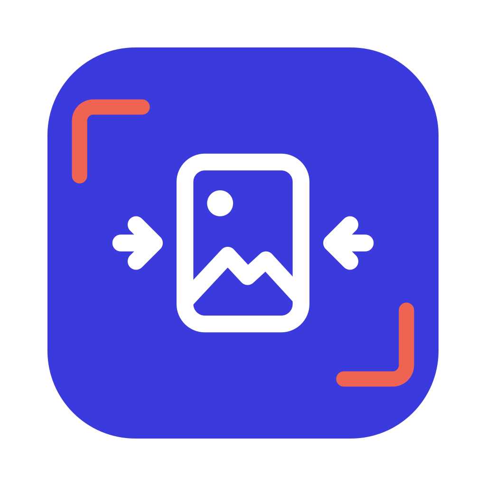
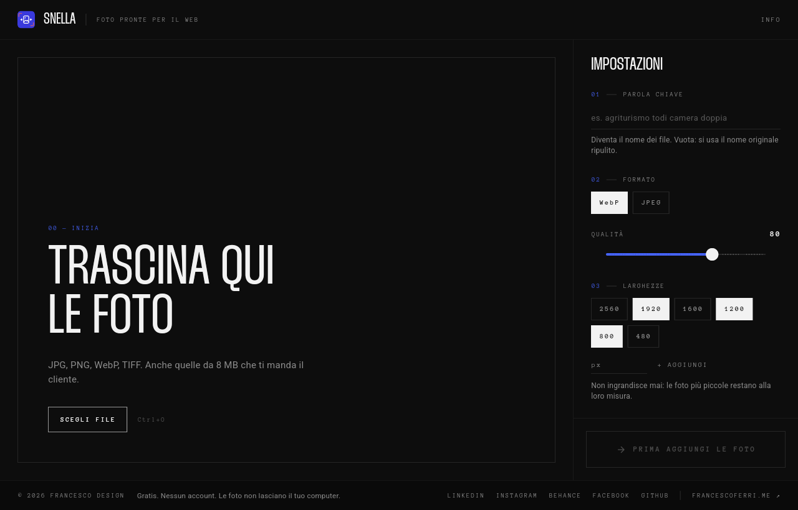
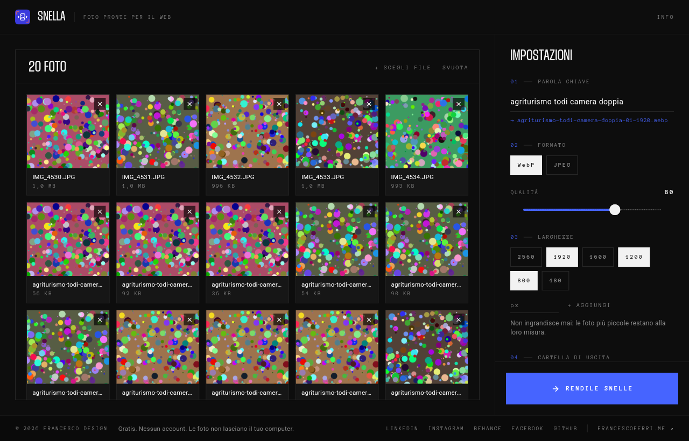
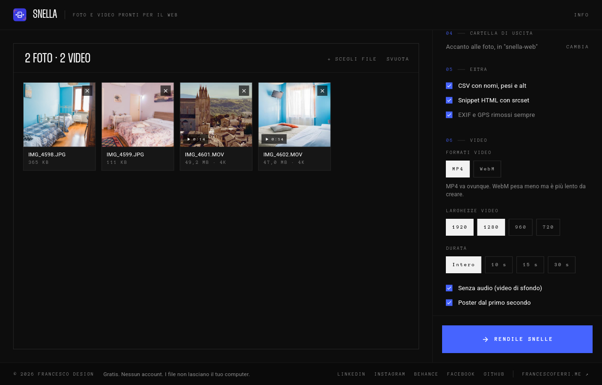
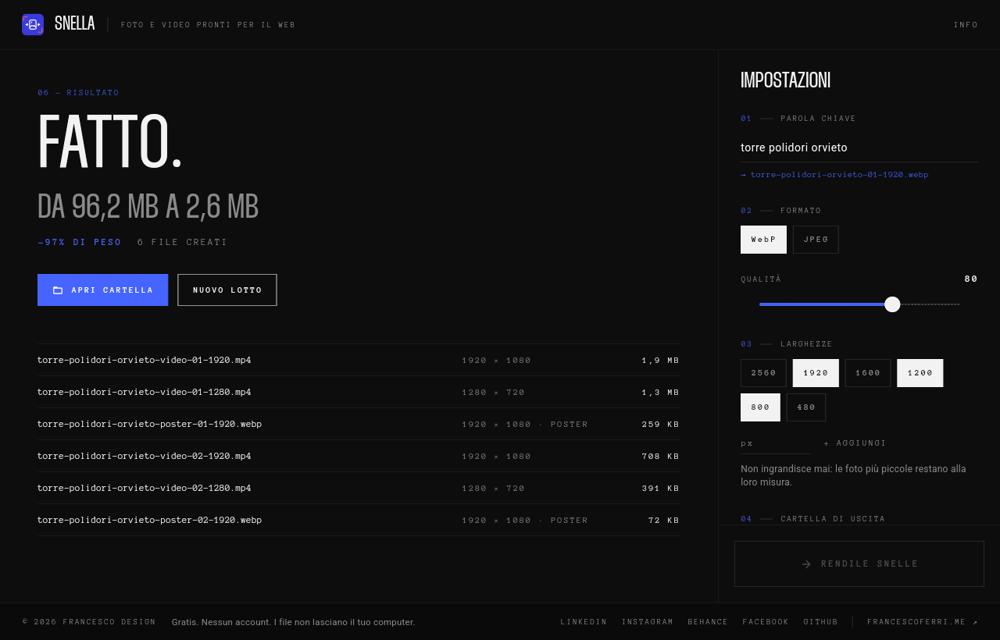

<p align="center">
  
</p>

<h1 align="center">Snella</h1>
<p align="center"><strong>Foto e video pronti per il web.</strong> Un'app gratuita per Mac e Windows di <a href="https://www.francescoferri.me">Francesco Ferri</a>.</p>


## Cosa fa

Il cliente ti manda 40 foto da 8 MB chiamate `IMG_4532.JPG`. Le trascini in Snella e con un click ottieni:

- **WebP o JPEG** alla qualità che scegli
- **le larghezze che ti servono** (2560, 1920, 1200, 800… o la tua). Non ingrandisce mai
- **nomi pronti per la SEO**: `agriturismo-todi-camera-doppia-03-1200.webp`
- **foto raddrizzate** secondo l'orientamento dello scatto
- **EXIF e GPS rimossi**: niente modello del telefono, niente coordinate di casa del cliente
- **un CSV** con nomi, misure, pesi e un alt di partenza da rifinire e incollare nel CMS
- **uno snippet HTML** con `srcset`, `sizes`, `width`/`height` e `loading="lazy"`

## E i video

Il video del drone da 50 MB per la hero? Trascinalo insieme alle foto. Snella crea:

- **MP4 H.264**, che va su tutti i browser, e se vuoi anche **WebM**, più leggero
- **le larghezze giuste**: 1920 per il desktop e 1280 per i telefoni, o quelle che scegli. Non ingrandisce mai
- **senza audio**, per i video di sfondo che partono da soli (puoi tenerlo, se ti serve)
- **tagliato a 10, 15 o 30 secondi**, se il cliente ti manda tre minuti di girato
- **ottimizzato per lo streaming** (`faststart`), a 30 fps al massimo e senza metadati
- **un poster** in WebP o JPEG, da mostrare mentre il video carica
- **uno snippet `<video>`** con `autoplay muted loop playsinline`, le versioni per i telefoni e il poster

Due video in 4K da 96 MB diventano 2,6 MB in tutto.

Funziona tutto in locale: i file non lasciano il tuo computer. Nessun account, nessun abbonamento.

| Vuota | Con le foto |
| --- | --- |
|  |  |

| Foto e video | Video pronti |
| --- | --- |
|  |  |

## Scaricala

Vai su [Releases](../../releases) e prendi lo zip per il tuo sistema.

- **Mac**: estrai `Snella.app` e spostala in Applicazioni. Se al primo avvio macOS la blocca: Impostazioni di Sistema → Privacy e sicurezza → **Apri comunque**.
- **Windows**: estrai la cartella e avvia `snella.exe`. Se compare SmartScreen: **Ulteriori informazioni → Esegui comunque**.

## Scorciatoie

| | Mac | Windows |
| --- | --- | --- |
| Scegli file | `⌘O` | `Ctrl+O` |
| Avvia | `⌘↵` | `Ctrl+Invio` |

Puoi trascinare anche intere cartelle: Snella cerca foto e video anche nelle sottocartelle.

## Compilarla

Serve [Flutter](https://docs.flutter.dev/get-started/install) stable (3.50 o successivo) e un compilatore C:
Xcode Command Line Tools su Mac, Visual Studio Build Tools su Windows, `build-essential` su Linux.

```bash
flutter pub get
flutter test
flutter run -d macos      # oppure: -d windows, -d linux
flutter build macos       # build di release
```

La codifica WebP usa libwebp tramite [swipelab_webp](https://pub.dev/packages/swipelab_webp):
alla prima build il sorgente di libwebp viene scaricato e compilato in automatico.

Per i video Snella usa [FFmpeg](https://ffmpeg.org). Negli zip della release è già incluso.
Quando la lanci da sorgente cerca quello del sistema: su Mac `brew install ffmpeg`,
su Windows `winget install ffmpeg`, su Linux `sudo apt install ffmpeg`.

Per pubblicare una nuova versione basta un tag: `git tag v1.1.0 && git push --tags`.
La GitHub Action in `.github/workflows/release.yml` crea gli zip per Mac e Windows, ci mette dentro ffmpeg e li allega alla release.

## Struttura

```
lib/
  main.dart            avvio dell'app
  src/processor.dart   lettura, ridimensionamento, codifica, CSV e srcset
  src/video.dart       video con ffmpeg: versioni, poster e snippet <video>
  src/home_page.dart   interfaccia
  src/widgets.dart     pulsanti, chip e logo
  src/brand.dart       colori, font e link
  src/strings.dart     testi in italiano e inglese
test/
  processor_test.dart
  video_test.dart
```

## Chi l'ha fatta

Sono **Francesco Ferri**, designer e sviluppatore web a Todi.
Progetto siti cuciti sul comportamento reale di chi li usa, così il sito smette di essere un costo e inizia a convertire.

**[francescoferri.me](https://www.francescoferri.me)** · [info@francescoferri.me](mailto:info@francescoferri.me)

[LinkedIn](https://www.linkedin.com/in/francescoferri97/) · [Instagram](https://www.instagram.com/fdesign1997) · [Behance](https://www.behance.net/francescodesign97) · [Facebook](https://www.facebook.com/share/14v4FfKoxgz/?mibextid=wwXIfr) · [GitHub](https://github.com/Francisff97)

## Licenza

Codice sotto licenza [MIT](LICENSE). Il font FD Display, il logo FD e l'icona dell'app restano di Francesco Ferri, tutti i diritti riservati.

L'eseguibile FFmpeg incluso negli zip è un programma separato sotto licenza GPL: dettagli e sorgenti in [third_party/FFMPEG.txt](third_party/FFMPEG.txt).
